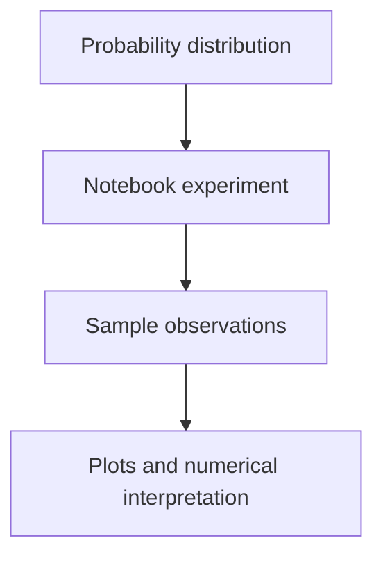

# Probability and Statistics Simulations

Coursework notebooks illustrating discrete random variables and simulation. Open them directly on GitHub or in Jupyter.



| Notebook | Topic |
| --- | --- |
| [Bernoulli](Bernoulli.ipynb) | Binary outcomes |
| [Binomial](Binomial.ipynb) | Counts across trials |
| [Poisson](Poisson.ipynb) | Discrete event counts |
| [Simulation homework](Simulation%20HW1%20Claude.ipynb) | Archived course simulation |

## Installation and demo
```sh
python -m venv .venv
source .venv/bin/activate
python -m pip install jupyter numpy scipy pandas matplotlib
jupyter notebook
```

Open one notebook and inspect/rerun its cells. The notebooks themselves are the demo; results can depend on randomness, seeds and environment. No speed benchmark or newly executed result is claimed in this documentation.

## Individual contribution
Yash Raj's archived coursework simulations. The original notebook names and source are preserved; no new experiments or authorship of third-party material are asserted.
